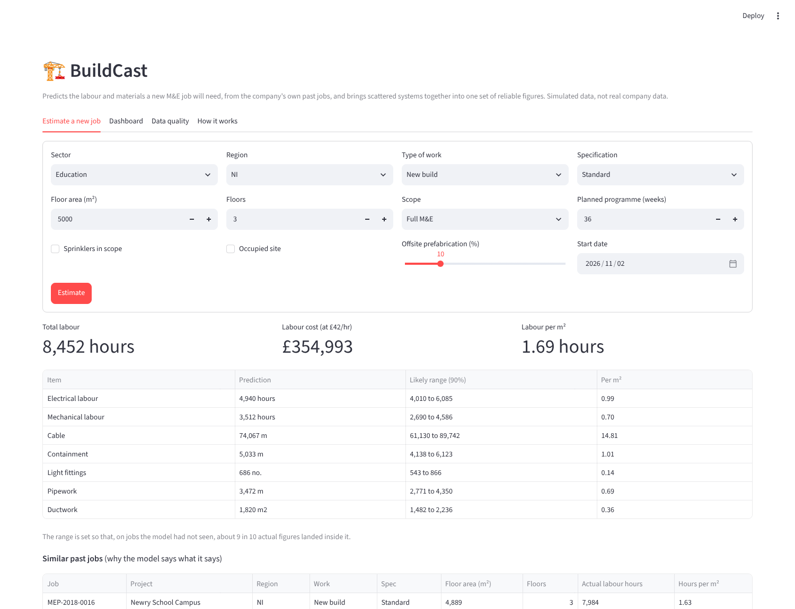
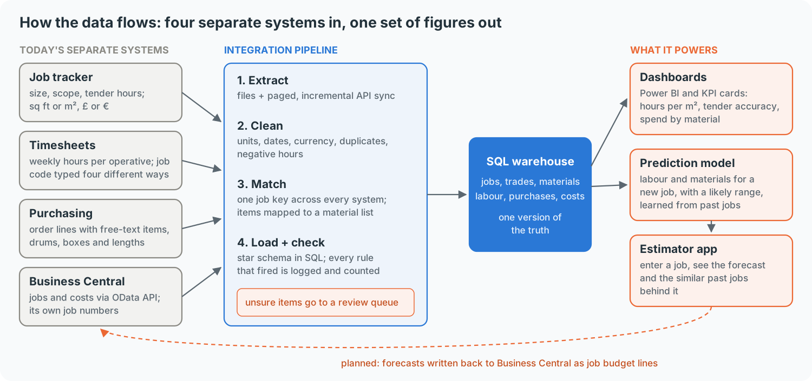
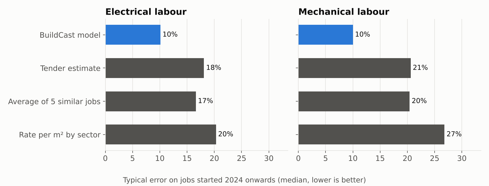
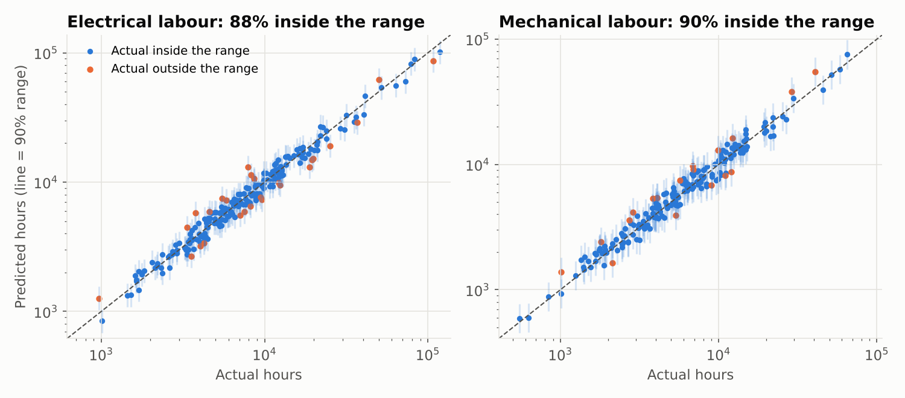
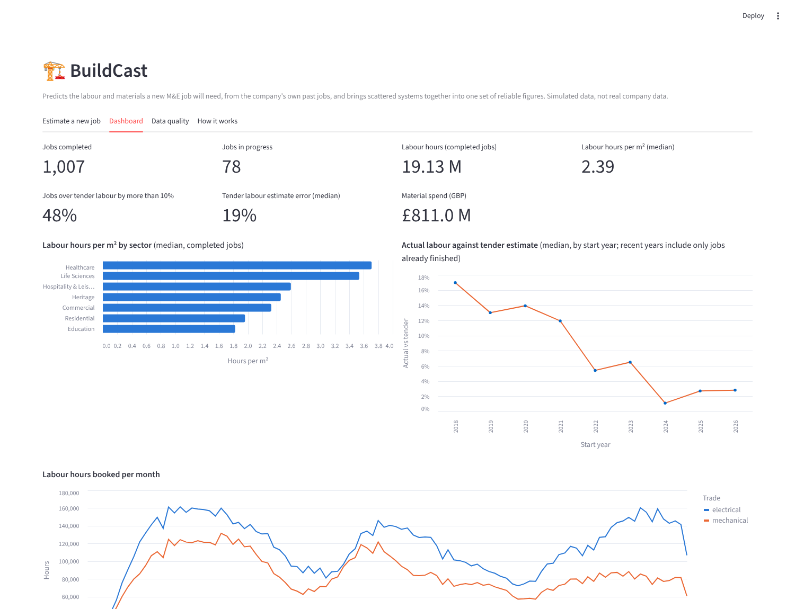
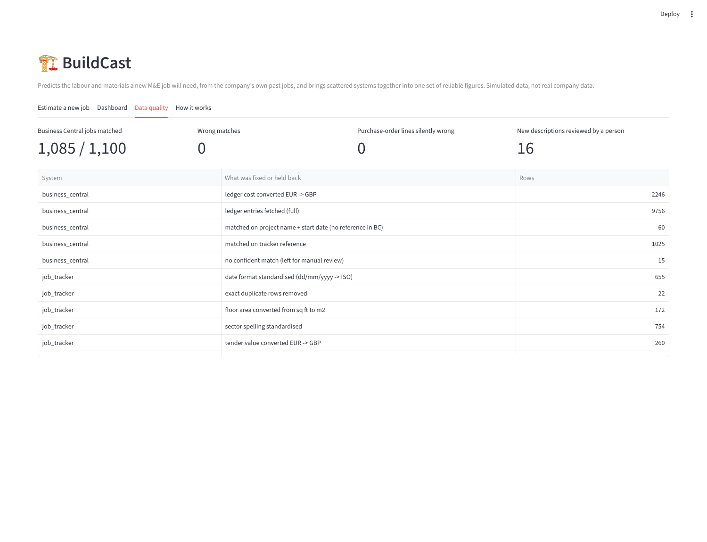

# BuildCast

[](https://github.com/sparobanks/buildcast/actions/workflows/ci.yml)


**Predicting the labour and materials a new mechanical and electrical (M&E) job will need, from the company's own
past jobs.**

Contractors usually keep their job history in several systems that don't talk to each other: an estimating
spreadsheet, a timesheet system, a purchasing system and a finance system such as Microsoft Business Central.
BuildCast joins them into one clean database, puts the key figures on a dashboard, and uses past jobs to predict
the hours and materials for a new one, with an honest range.



> **All data here is simulated.** A contractor's job history is confidential, so BuildCast comes with a
> realistic simulator of an M&E contractor working across Northern Ireland, Great Britain and Ireland. The point
> is the method, which works the same way on real data.

---

## The idea in one minute

When an estimator prices a new job, they usually rely on rates per square metre and experience. That works,
but in this simulated company the tender labour estimate is off by about **19%** on a typical job, and
**48%** of jobs go more than 10% over the tendered hours.

The information to do better already exists in past jobs. It's just scattered:

- the **job tracker** knows the size and scope of each job,
- **timesheets** know the hours actually worked,
- **purchasing** knows the materials actually bought,
- **Business Central** knows the costs.

BuildCast brings them together, then learns from them.

---

## How it works



1. **Map the data.** Four separate systems, each with its own job numbering, units and mistakes.
2. **Integrate.** A pipeline reads each system (including Business Central through its OData API, a page at a
   time and only what's new since the last run), cleans it, matches every record to the right job, and loads it
   into one SQL database.
3. **Report.** KPI cards and charts: labour hours per m², tender accuracy, spend by material. Ready for Power BI.
4. **Predict.** For a new job, predict labour hours (electrical and mechanical) and six key material quantities,
   each with a likely range.
5. **Use it.** A simple screen where an estimator enters a job and sees the forecast, plus the similar past jobs
   behind it.

---

## What I found

### 1. Joining the systems: nothing silently wrong

The simulator also writes a hidden answer key, so every step of the pipeline can be checked. The pipeline never
reads it.

| Check | Result |
|---|---|
| Business Central jobs matched to the right job | **1,085 of 1,100**, with **0 wrong** (15 left for a person to check) |
| Purchase-order lines given the wrong material or quantity without warning | **0 of 20,483** |
| Labour hours per job within 2% of the truth | **96%** of jobs |
| Cable and pipework totals per job within 2% of the truth | **99.9%** and **97%** of jobs |

Every fix is counted, for example 6,754 duplicate timesheets removed, 1,562 negative or zero hours held back,
172 floor areas converted from sq ft, and 4,790 costs converted from euros.

**The review queue.** I also tested the pipeline on purchase-order wording it had never seen (other suppliers'
phrasing, abbreviations and typos, about 15% of lines). Rather than guess, it held all 3,042 of those lines
for review. Those lines used only **16 different descriptions**, so one person mapping each description once fixed
all 3,042 lines, and every future order with the same wording. Before that review, cable totals were 7% short on a
typical job; after it, they were within 0.1%.

### 2. Predictions: about half the error of the tender estimate



Tested fairly on time: the model learned from jobs that started **before 2023**, its ranges were tuned on **2023**
jobs, and it was scored on **2024 onwards**, as if predicting jobs that hadn't happened yet.

| Labour (jobs started 2024 onwards) | BuildCast | Tender estimate | 5 similar past jobs | Rate per m² |
|---|---|---|---|---|
| Electrical hours, typical error | **10%** | 18% | 17% | 20% |
| Mechanical hours, typical error | **10%** | 21% | 20% | 27% |

| Materials, typical error | BuildCast | Rate per m² | 5 similar past jobs |
|---|---|---|---|
| Cable | **8.4%** | 11.6% | 9.6% |
| Containment | **7.9%** | 9.6% | 10.0% |
| Light fittings | **7.5%** | 7.8% | 9.0% |
| Pipework | **6.8%** | 10.8% | 9.5% |
| Ductwork | **7.6%** | 10.1% | 10.4% |
| Sprinkler heads | 11.0% | **9.9%** | 11.2% |

The model helps most on labour, where many things matter at once (type of work, region, floors, an occupied site,
offsite prefabrication). For materials the simple rate per m² is already close. For sprinkler heads it was
actually better, so in practice I'd keep the simple rate for those.

### 3. The ranges are honest



Each prediction comes with a range designed to contain the actual figure 9 times in 10. On the 2024 onwards jobs it
did **88%** of the time for electrical hours and **90%** for mechanical hours. A typical labour range is about
±20 to 25%, which tells the estimator how much contingency the history supports.

### 4. Dashboard and data quality



The same figures come as a ready-made **Power BI report**: open [`powerbi/BuildCast.pbip`](powerbi/README.md) in
Power BI Desktop, point it at the data folder and refresh. It contains the star-schema model (7 tables, 8
relationships), 9 KPI measures in DAX, and an overview page with KPI cards, charts and slicers.



---

## Try it yourself

```bash
git clone https://github.com/sparobanks/buildcast.git
cd buildcast
pip install -r requirements.txt
streamlit run app/app.py
```

The database and trained model are included, so the app works straight away. To rebuild everything from scratch:

```bash
make all    # simulate the systems, run the pipeline, train, export for Power BI, draw charts (~3 min)
make test   # 20 automatic checks, also run on every update
```

| App tab | What you can do |
|---|---|
| **Estimate a new job** | Enter a job; see labour and materials with ranges and the similar past jobs behind them |
| **Dashboard** | KPI cards, hours per m² by sector, tender accuracy, hours booked per month |
| **Data quality** | What the pipeline fixed, held back or couldn't match |
| **How it works** | The data-flow map |

Guides: [training guide for estimators](docs/training_guide.md) · [Power BI report and guide](powerbi/README.md)

---

## For technical readers

| Part | What it uses |
|---|---|
| Simulator | 1,100 jobs (2018 to mid-2026) across 7 sectors, 3 regions, GBP and EUR; multiplicative quantity and productivity model with hidden factors (site team, client variations) |
| Integration | pandas; regex job-code canonicalisation; keyword rules + RapidFuzz for materials; pack-size parsing; review queue; SQLite star schema; data-quality log |
| Business Central | FastAPI mock of OData v4 web services (`$top`/`$skip`, `@odata.nextLink`, `$filter` on modified date); client with incremental sync and a stored watermark |
| Models | per target, log-linear (ridge) and gradient boosting compared on 2023 jobs, the better one kept; split-conformal 90% ranges calibrated on 2023 jobs |
| Explanation | the five most similar past jobs (same sector and scope; nearest on size, floors, work type, spec, region) |
| App and reporting | Streamlit + Altair; Power BI Project (PBIP): semantic model with DAX measures and a KPI report page |

### Project structure

```
buildcast/
├── buildcast/
│   ├── simulate.py     the four source systems, with a hidden answer key
│   ├── bc_api.py       Business Central OData mock and sync client
│   ├── pipeline.py     extract, clean, match, load, data-quality log, audit
│   ├── model.py        forecasting models, ranges, baselines, similar jobs
│   └── kpis.py         KPI cards and summaries
├── scripts/            run_pipeline, train, export_powerbi, figures, simulate_reviewer
├── app/app.py          estimator app and dashboard
├── powerbi/            Power BI project (BuildCast.pbip), star schema CSVs, DAX measures, guide
├── config/             exchange rates, labour rate, reviewed material mappings
├── data/warehouse.db   the integrated database (raw files rebuild with `make data`)
├── models/             trained forecaster
├── reports/            every number in this README, as data files
└── docs/               training guide, diagrams, screenshots
```

---

## Limits and what's next

- **Simulated data.** The results show the method works on data with these properties, not how accurate it would
  be on a particular company's jobs. The simulator builds quantities and hours by multiplying factors together,
  which suits the log-linear model; real data is messier, which is why both model types are compared every time.
- **Recent jobs.** The test uses jobs that have finished, so long jobs started in 2025 are under-represented.
- **Business Central.** The connector matches Business Central's OData conventions but has not been run against a
  live tenant, which needs Microsoft Entra ID sign-in and the company's own published web services.
- **The reviewer is simulated.** The review queue is real; the person filling it in was played by the answer key.
- **The "tender accuracy by year" chart improves over time** partly because the simulator builds in a steady
  productivity gain that the tender rule of thumb doesn't. On real data, that chart is one to watch, not assume.
- **Next:** write forecasts back into Business Central as job budget lines, predict programme risk (which jobs are
  likely to finish late), and retrain automatically as each job closes.

---

## Author

**Jasper Chinedu Nwangere** ([@sparobanks](https://github.com/sparobanks)), AI/ML Engineer. MIT licensed.
